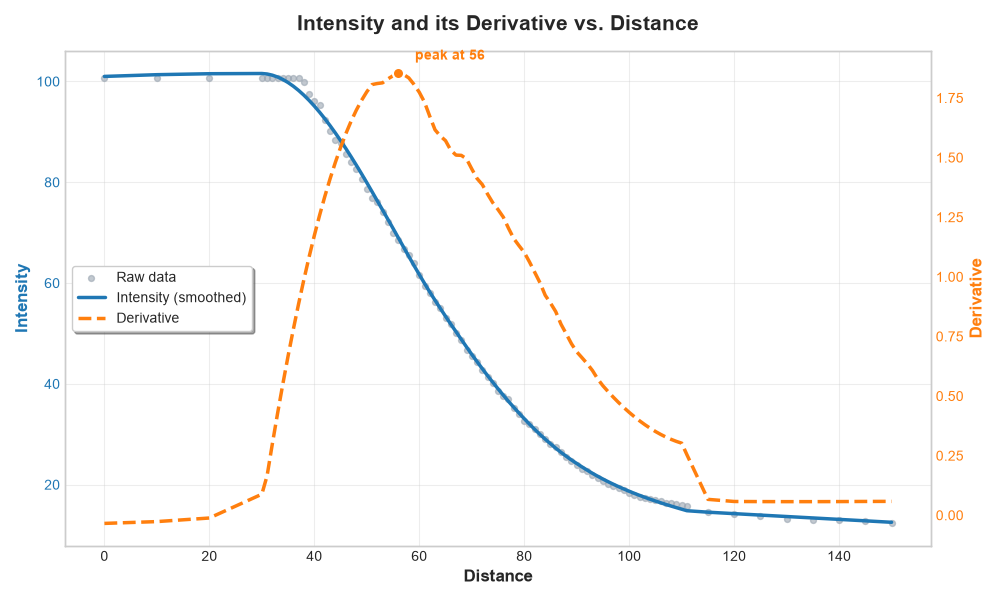
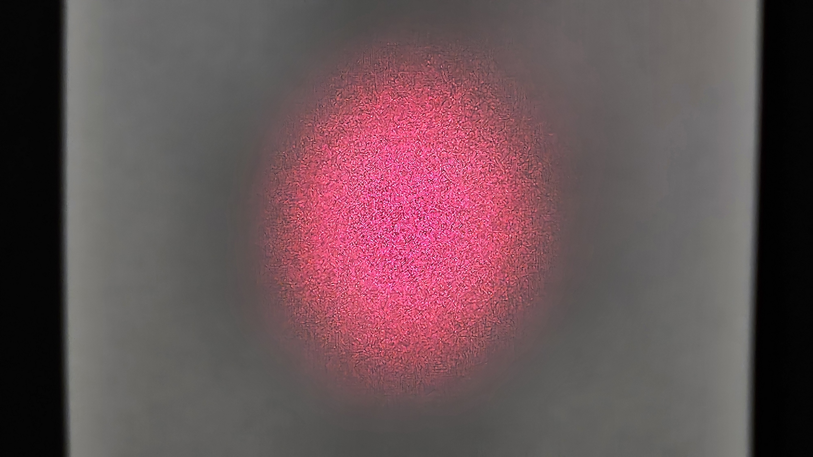
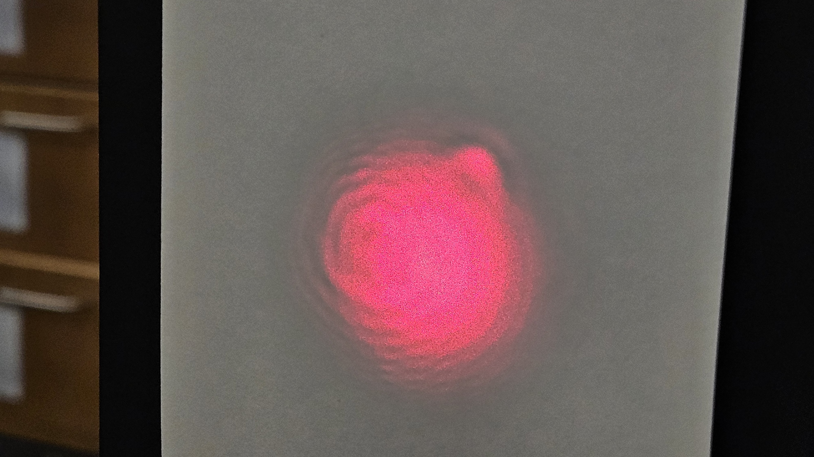

Lab 2 Extended Abstract

ROUGH DRAFT

# Measuring the Intensity of HeNe Laser Beam with a Rasor Blade.

## Introduction

This experiment details the empirical determination of the spatial intensity profile and beam radius ($w$) of a Helium-Neon (HeNe) laser. 
Because direct measurement of high-intensity, narrow-waist laser beams presents spatial resolution challenges for standard photodetectors, a beam expansion technique is paired with precision mechanical sampling. 
The unexpanded laser beam is first directed into two mirrors.
This will allowing for orthogonal transverse adjustments to align the beam exactly parallel to the optical table. 
The steered beam then propagates through a two-lens telescope system with a magnification factor of approximately $M \approx 4$. 
This optical expansion is a critical procedural step.
The beam is inflated to have a larger spatial cross-section of the beam.
This will make the mechanical sampling by utilizing a razor blade to capture a significantly higher density of data points across the intensity gradient. 
The fundamental mode ($TEM_{00}$) of a HeNe laser follows a 2D Gaussian intensity distribution which is radial.
At each increment, a downstream photodetector measures the total integrated optical power of the unblocked light. 
Mathematically, this measured power corresponds to the 2D surface integral of the Gaussian profile from the blade's position to infinity, resulting in an S-shaped response curve described by the complementary error function. 
The original 1-dimensional Gaussian intensity profile is subsequently recovered by taking the numerical derivative of this experimental power data with respect to the blade position. 
By fitting the resulting bell curve to a standard Gaussian function, the expanded beam radius can be precisely extracted. 
The radius of the original, unexpanded laser beam can then be calculated by dividing the experimental result by the square of the beam expander's magnification factor.

$I(r) = I_0 exp\frac{-2r^2}{w^2}$\
The intensity at the radial distance *r* from the center.

$M = \frac{f_2}{f_1} = \frac{w_2}{w_1}$\
M is the Magnification factor of the two different lenses, or the beam waist sizes.

## Graph

